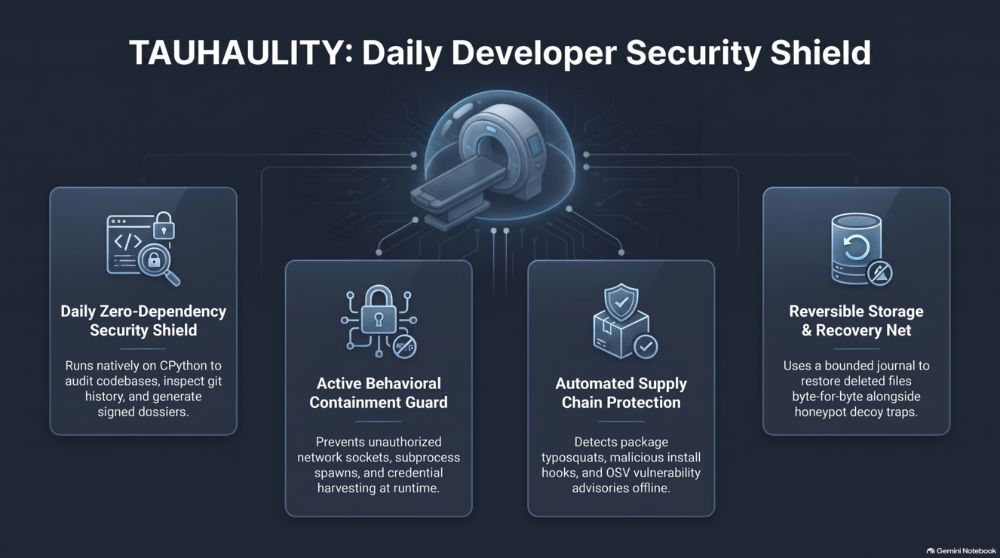
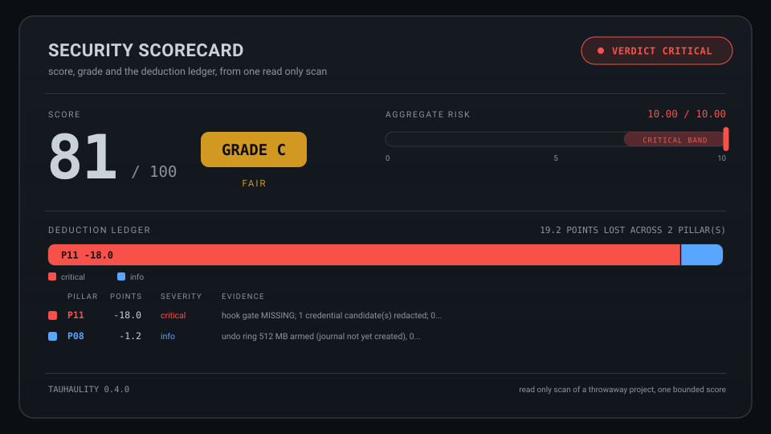
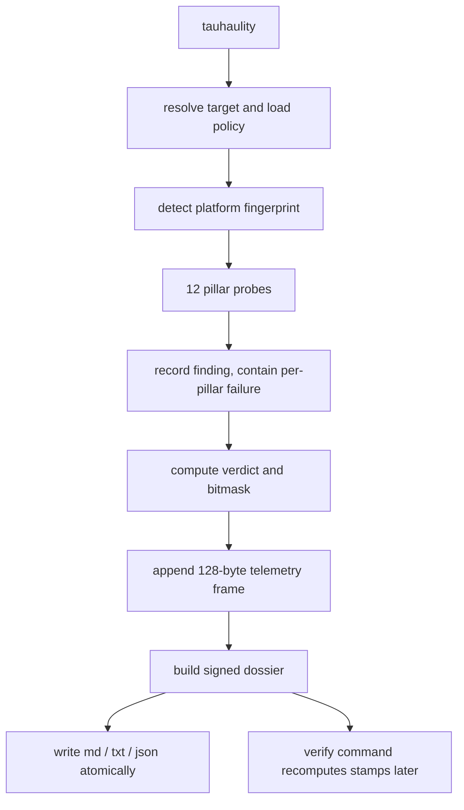
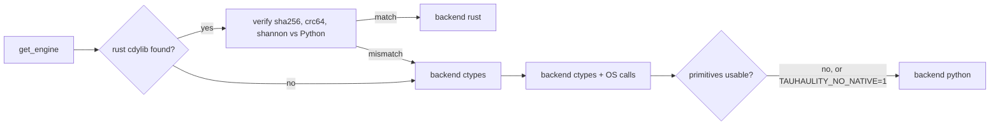

# TAUHAULITY

<p align="center">
  
</p>

### The 12-pillar project shield you will actually run every day

<p align="center">            </p>

<p align="center"><a href="https://osv.dev"></a> <a href="https://github.com/ossf/malicious-packages"></a> <a href="https://www.cisa.gov/known-exploited-vulnerabilities-catalog"></a> <a href="#how-much-protection-does-this-actually-give"></a>   </p>

<p align="center">
  <sub>Zero third-party runtime dependencies · English-only output · Windows Native + WSL2 Ubuntu/Debian · CPython 3.12 to 3.15 including the free-threaded builds · optional Rust silicon core with a transparent ctypes / pure-Python fallback</sub>
</p>

---

> [!IMPORTANT]
> Tauhaulity is a **daily developer utility**. One command inside a project produces a signed 12-pillar dossier (md, txt, json) plus the side tools developers actually need: undo net, git secret gate, port sweeper, virtual-environment radar, onboarding setup, shell shim, watcher and dossier verification.

> [!NOTE]
> Every number in this README was measured on the machine described in **[Verified test matrix](#verified-test-matrix)**. Where a mechanism is a capability report rather than an enforcement hook, it is listed explicitly in **[Enforced vs reported](#enforced-vs-reported)**.

## Navigation

| Section | What you get |
|---|---|
| [Start in 60 seconds](#start-in-60-seconds) | Three ways to run it right now |
| [What one command gives you](#what-one-command-gives-you) | The scan output and the files it writes |
| [Five-minute setup](#five-minute-setup) | One command that configures a project |
| [Command reference](#command-reference) | All 27 commands, exit codes, files |
| [Daily workflows](#daily-workflows) | Copy-paste recipes for each tool |
| [The 12 pillars](#the-12-pillars) | What each probe measures |
| [Enforced vs reported](#enforced-vs-reported) | The honesty table |
| [Dossiers and verification](#dossiers-and-verification) | Signed reports and how to verify them |
| [Policy and the sign-off form](#policy-and-the-sign-off-form) | Declarative policy from checkboxes |
| [Architecture](#architecture) | Engine flow, 128-byte frame, seqlock, SPSC |
| [Native engine tiers](#native-engine-tiers) | rust, ctypes, python and how to build them |
| [How much protection does this actually give?](#how-much-protection-does-this-actually-give) | Measured detection versus prevention, scenario by scenario |
| [What the detectors actually catch](#what-the-detectors-actually-catch) | Red-team corpus: 100 attack scenarios, recall per class |
| [Does it survive real use](#does-it-survive-real-use) | Usage corpus: 100 scripted command journeys |
| [Verified test matrix](#verified-test-matrix) | Platform and interpreter legs |
| [Benchmarks](#benchmarks) | Reproducible latency and throughput numbers |
| [Limitations](#limitations) | What it does not do |
| [Development](#development) | Tests, matrix runner, adding a pillar |
| [Changelog](#changelog) | What changed in each version |

---

## Start in 60 seconds

### Route A: single file, no install (shipped in this repository)

```console
python dist/tauhaulity.pyz setup .
python dist/tauhaulity.pyz
```

The zipapp is a single 413 KB file built from this package; it runs on any CPython 3.12+ without a virtual environment, a package manager or network access.

### Route B: install the built wheel

The repository ships its release artifacts in `dist/`, built without a build backend so a release needs nothing but a CPython interpreter:

```console
python scripts/build_release.py              # rebuilds wheel + zipapp + SHA256SUMS
python -m pip install dist/tauhaulity-0.4.0-py3-none-any.whl
tauhaulity setup .
tauhaulity
```

```console
# an isolated install, if you prefer one:
pipx install dist/tauhaulity-0.4.0-py3-none-any.whl
```

`dist/SHA256SUMS` covers both artifacts, and `tests/test_release_artifacts.py` re-verifies every PEP 427 RECORD digest, the console entry point and an end-to-end zipapp scan on each run.

### Route C: run from the checkout

```console
python -m tauhaulity setup
python -m tauhaulity
```

All three routes run identical code. The only difference is how the command is invoked.

---

## What one command gives you

```text
$ tauhaulity
TAUHAULITY SCAN - /home/dev/core_service
------------------------------------------------------------------------------
P01 [SAFE             ] risk  0.0  pointer table read-only: GOT at 0x7f2c... (r--p); 41 executable private mapping(s)
P02 [SAFE             ] risk  0.0  atomic 8-byte swap via hardware cas; ptrace_scope=1; seccomp mode=2
P03 [SAFE             ] risk  0.0  32-opcode CoW vm self-test passed: transfer committed, overdraft rejected
P04 [READY            ] risk  0.0  mirage ready: namespace, phantomfs; phantomfs lifecycle verified in memory
P05 [SAFE             ] risk  0.0  32 byte secret pinned via mlock; rotating XOR mask verified (1 rotation)
P06 [SAFE             ] risk  0.0  benign pickle accepted=True, malicious pickle blocked=True (GLOBAL, REDUCE)
P07 [SAFE             ] risk  0.0  pre-tls capture=yes, ssl hook=yes, dns tunnel blocked=True; 2 secret pattern(s)
P08 [PROTECTED        ] risk  0.5  undo ring 512 MB armed; 1 canary trap(s); inspected 0 file(s) within entropy budget
P09 [CLEAN            ] risk  0.0  14 listening socket(s) via procfs; no conflicting dev ports
P10 [CLEAN            ] risk  0.0  engine tier FULL_RUST_PY_SHIELD; no virtual environment tampering
P11 [SECURE           ] risk  0.0  hook gate installed; 0 credential candidate(s); 13 suppressed by the baseline
P12 [GENERATED        ] risk  0.0  repro_slot_11.py written
------------------------------------------------------------------------------
verdict: SAFE (risk 0.50) on 12 pillars in 390 ms
report[md]: /home/dev/core_service/tauhaulity_report.md
report[txt]: /home/dev/core_service/tauhaulity_report.txt
report[json]: /home/dev/core_service/tauhaulity_report.json
```

Files written (all atomic, temp file plus rename):

| Path | Contents |
|---|---|
| `tauhaulity_report.md` | Human dossier with the sign-off form |
| `tauhaulity_report.txt` | Display-width-correct plain text |
| `tauhaulity_report.json` | Stable schema for CI, diffing and verification |
| `.tauhaulity/policy.json` | Effective policy written by apply |
| `.tauhaulity/allowlist.json` | Accepted credential fingerprints (baseline) |
| `.tauhaulity/telemetry.frames` | Append-only 128-byte verdict frames |
| `.tauhaulity/undo/` | Bounded undo journal |
| `.tauhaulity/repro/` | Synthesized reproduction scripts |

---

## Five-minute setup

```console
$ tauhaulity setup .
tauhaulity setup - /home/dev/core_service
  [PASS] python                   3.12.10
  [PASS] native_engine            rust 0.2.0
  [PASS] pillar_registry          12/12 pillars
  [DONE] git gate installed at /home/dev/core_service/.git/hooks/pre-commit
  [INFO] 2 credential candidate(s) visible; run 'tauhaulity baseline' only for known fixtures
next steps:
  tauhaulity                 # 12-pillar scan and dossier export
  tauhaulity shim install    # optional: undo-aware delete wrapper
```

What setup does:

1. Runs the capability self-check and stops if a capability is missing.
2. Installs the pre-commit credential gate when the target is a git repository.
3. Reports how many credential candidates are visible **without accepting them**.
4. Prints the exact next commands.

What setup deliberately does **not** do:

- It never records a credential baseline automatically. Onboarding often happens while a real `.env` is staged, and silently whitelisting it would defeat the gate. Pass `--baseline` only when the current candidates are known fixtures.
- It never modifies shell startup files. The optional shim is a separate explicit command.

---

<a id="command-reference"></a>
<details><summary><strong>Command reference</strong> - all 27 commands, exit codes and files</summary>

| Command | Purpose | Mutates state? |
|---|---|---|
| `tauhaulity` | Zero-argument scan of the current directory, all three formats | writes dossiers |
| `tauhaulity audit [path] --export md,txt,json --out DIR --deep --no-repro --json` | Scan with explicit target and flags | writes dossiers |
| `tauhaulity setup [path] --no-hook --baseline` | One-command onboarding | hook, optional baseline |
| `tauhaulity baseline [path] --reset` | Accept current credential candidates as known | writes allowlist |
| `tauhaulity baseline --memory` | Capture the executable memory baseline of the interpreter | writes memory baseline |
| `tauhaulity suppress list / add / reset` | Review and record accepted scanner findings with a reason | writes suppressions |
| `tauhaulity deps [path] --json` | Audit declared dependencies before installing them | read-only |
| `tauhaulity vulns [path] --online --enrich` | Check pinned dependencies against the OSV advisory database | writes a cache |
| `tauhaulity guard status / denials / policy` | Inspect the interpreter guard and what it blocked | read-only |
| `tauhaulity shield -- <command>` | Run a command with containment enforcing | runs a child process |
| `tauhaulity quarantine list / apply / restore / purge` | Move a dangerous artefact out of the load path, reversibly | moves files |
| `tauhaulity ci [path] --online --fail-on critical` | Scan, dependencies and advisories in one gate with one exit code | read-only |
| `tauhaulity feed status / refresh` | Show the age of the cached threat data, or refresh it | writes a cache |
| `tauhaulity posture [path] --json --strict` | What protects this machine now, what is stale, and what it cannot cover | read-only |
| `tauhaulity honeytoken deploy / status / remove` | Decoy credential traps whose first read is an alert | writes decoys |
| `tauhaulity canary deploy / status / remove` | Plant or inspect ransomware bait files across real source directories | writes decoys + manifest |
| `tauhaulity verify <report> --key <hex|file> --no-machine-key` | Verify a dossier integrity stamp | read-only |
| `tauhaulity undo [--list] [--id ID]` | List or restore journal entries | restores files |
| `tauhaulity rm <paths...> --dry-run` | Capture then delete, making it reversible | deletes + journals |
| `tauhaulity shim install|uninstall|status|print --shell auto|bash|powershell --override-rm` | Undo-aware delete wrapper | writes shell profile |
| `tauhaulity watch [path] --interval 1.0 --duration N --freeze --backend auto|linux|windows|polling` | Watch canaries and ciphertext events on a kernel notification backend | read-only |
| `tauhaulity free <port> --dry-run --yes --force` | Terminate the process holding a port | terminates processes |
| `tauhaulity ports --json` | List listening sockets with owners | read-only |
| `tauhaulity hook install|uninstall|status [path] --warn-only` | Manage the git pre-commit gate | writes a hook |
| `tauhaulity venv-check [path] --json` | Inspect virtual environments | read-only |
| `tauhaulity apply <form.md> [--root PATH]` | Turn checked boxes into active policy | writes policy |
| `tauhaulity doctor --json` | Capability self-check | read-only |
| `tauhaulity bench --runs N --json` | Measure command latency and throughput | read-only |
| `tauhaulity diff <old.json> <new.json>` | Compare two dossiers | read-only |

### Exit codes

| Code | Meaning |
|---|---|
| 0 | SAFE verdict or command succeeded |
| 1 | AT_RISK verdict, unconfirmed destructive action, or verified failures |
| 2 | CRITICAL verdict |
| 3 | Usage or runtime error |
| 4 | Command unavailable in this build |

### Safety rails

| Rails | Behaviour |
|---|---|
| `free` | Prints a preview of the owning processes; a non-interactive run refuses without `--yes`; never signals its own PID, PID 0 or PID 1 |
| `rm` | Journals before deleting; `--dry-run` shows exactly what would be captured; `tauhaulity undo` restores it |
| `baseline` | Explicit and reversible; `--reset` removes the allowlist |
| `verify` | Constant-time comparisons; never echoes key material |

</details>

<a id="daily-workflows"></a>
<details><summary><strong>Daily workflows</strong> - copy-paste recipes for each tool</summary>

### Recover a deleted file

```console
tauhaulity rm build/cache          # capture then delete
tauhaulity undo --list             # inspect the journal
tauhaulity undo                    # restore the newest entry
```

### Stop a real secret from being committed

```console
tauhaulity hook install            # installs .git/hooks/pre-commit
git commit -m "wip"                # blocked before the object is written
```

The gate fails **closed**: if the scanner cannot run, the commit is blocked with an explicit message rather than passing silently. `--warn-only` is the documented opt out.

### Silence fixture noise without hiding real leaks

```console
tauhaulity baseline .              # accept the current candidates as known
tauhaulity audit . --json          # pillar 11 now reports suppressed counts
tauhaulity baseline . --reset      # forget them again
```

### Release a hung dev port

```console
tauhaulity ports                   # native socket table, no lsof / netstat
tauhaulity free 8000 --dry-run     # preview owners
tauhaulity free 8000               # prompts; --yes for CI
```

### Make deletion reversible from your shell

```console
tauhaulity shim print --shell bash         # inspect the snippet first
tauhaulity shim install --shell auto       # adds trm to the profile
trm old_build/                              # undo-aware delete
tauhaulity shim uninstall --shell auto      # restores the backup byte for byte
```

The shim installs `trm` by default. Replacing the real `rm` requires `--override-rm` and is marked as an override inside the installed block.

### Watch for ransomware-like behaviour

```console
tauhaulity canary deploy .                # 40 ordinary looking decoys, one per source directory
tauhaulity canary status .                # manifest digest and armed families
tauhaulity watch . --interval 1.0 --duration 60
tauhaulity guard status                   # burst counters and the last verdict
```

The watch loop prints one English line per event, classifies a farm decoy as `canary_modified`, `canary_deleted` or `canary_replaced`, and arms the backup observer that recognises shadow copy and backup deletion commands. The guard adds a write-burst verdict when at least 30 destructive operations land inside 5 seconds and at least 80 percent of the renames share a suffix the process never used during its first window; `TAUHAULITY_DENY_RANSOM_BURST=1` turns the verdict into a refusal of the crossing operation. Process freeze still needs `--freeze` **and** the policy flag, and stays POSIX-only.

### Verify a dossier someone sent you

```console
tauhaulity verify tauhaulity_report.json            # canonical JSON signature
tauhaulity verify tauhaulity_report.md              # file stamp over every byte
tauhaulity verify report.md --key 64-hex-chars      # shared secret
tauhaulity verify report.md --no-machine-key        # require an explicit or env key
```

</details>

---

## What the detectors actually catch

Claims about detection are worth nothing without a measurement. This repository ships a **red-team corpus of 100 scenarios** (tests/corpus_cases.py), each one a real fixture tree plus the verdict a security review would expect. Every case runs the shipped engine end to end.

```console
python tests/corpus_runner.py            # table plus per-category recall
python tests/corpus_runner.py --json     # machine readable
python -m pytest tests -m corpus         # same corpus as a pytest run
```

### Measured result

| Attack / control class | Cases | Recall |
|---|---|---|
| Credentials in the working tree | 10 | 100% |
| Credentials already in git history (deleted later) | 10 | 100% |
| Unsafe pickle payloads (never executed during the scan) | 10 | 100% |
| Bytecode cache tampering (.pyc vs source) | 10 | 100% |
| Dangerous APIs (eval/exec/shell/load/extract) | 10 | 100% |
| Archive extraction without traversal validation | 10 | 100% |
| Virtual environment injection (.pth, sitecustomize, rogue binaries) | 10 | 100% |
| Installed distribution tampering (RECORD hash, typosquat) | 10 | 100% |
| Credential-bearing config files (.netrc, CI, k8s, docker) | 10 | 100% |
| Clean controls (must stay SAFE) | 10 | 100% |
| **Total** | **100** | **100%** |

The negative controls are the important half: documentation that merely names `GITHUB_TOKEN`, masked examples, minified bundles, licenses, benign pickles, valid pyc files and a clean virtual environment must all come out SAFE, and they do. A detector that flags everything protects nothing.

A third corpus gives the runtime protections the same measured treatment:

```console
python -m pytest tests/test_runtime_corpus.py -o addopts= -q
```

| Runtime detector | Cases | Pass |
|---|---|---|
| Honeytoken traps (deploy, alert on read, no clobber, scoped removal, corrupt manifest, visibly fake decoys) | 10 | 100% |
| Memory baseline (capture, changed, missing, new, corrupt store, byte budget, read-only scan, probe) | 10 | 100% |
| Watch backends (selection, detection, prompt stop, duration, freeze gating, protected PIDs, vanished file, idle CPU, canary) | 10 | 100% |

### What each detector really is

| Detector | Mechanism | Honest boundary |
|---|---|---|
| Credential sentinel | 18 token families (GitHub, GitLab, Google, Slack, Discord, Stripe, SendGrid, Twilio, npm, PyPI, AWS, Azure, JWT, PEM keys, database URIs, high-entropy assignments), masked before anything is written | Pattern and entropy based: an unknown issuer with low entropy is not caught |
| Git history scan | One bounded `git log --raw` plus batched `cat-file` reads of only the changed blobs; a credential deleted in a later commit is still reported, attributed to the commit that introduced it | Bounded to 200 commits and 1500 blobs by default, and it says when it truncated |
| Pickle firewall | Walks opcodes with `pickletools.genops` and never deserializes; a benign payload is not flagged | Reports the opcode family, not the full payload |
| Dangerous API scan | `ast.parse` over project sources, so strings and comments cannot trigger it | Syntactic: it finds the call site, not whether the input is actually attacker controlled |
| Bytecode verification | PEP-552 header, timestamp/size or checked-hash mode, `__pycache__` and legacy layouts | Header-level: it detects a stale or forged cache, not a semantically equivalent rewrite |
| Virtual environment radar | RECORD sha256 per installed file, `sitecustomize`/`usercustomize`, injection paths, offline typosquat distance | Typosquat is a heuristic and the detail says "resembles X (distance N)" |
| Port sentinel | Native socket tables with owner mapping and conflicting dev-port grouping | Observational: it does not scan remote hosts |
| Undo net and canaries | Bounded journal before deletion, a manifest-backed decoy farm with per-directory coverage, fingerprint and inode comparison, entropy radar with a hard byte budget | Detection is only as good as the deployed decoys; freeze requires an explicit flag and is POSIX-only |
| Write-burst detector | Sliding five second window over `os.remove`, `os.rename`, `os.replace` and `os.rmdir`: 30 operations, at least 10 rename samples, 80 percent suffix dominance, and a suffix the process did not use during its warm-up. Bounded 512-operation deque | It classifies volume and rename uniformity, not file content; slow encryption that renames few files stays below the threshold |
| Backup guard | Classifies recognised backup-destruction commands (`vssadmin delete shadows`, `wbadmin delete`) from audit events, and probes restore points read only | It observes processes that run under the guard; an encoded command line is reported as encoded, not decoded |

`tauhaulity baseline` accepts the current findings, including history findings, so a repository with a known legacy leak can still produce a clean signal without hiding anything new.

<details><summary><strong>Runtime protection added in 0.2.0</strong> - four capabilities that act on live behaviour</summary>

Beyond the posture pillars, four capabilities now act on live behaviour.

| Capability | How it works | How to use it |
|---|---|---|
| **Kernel event watching** | Linux: `inotify` through ctypes with a recursive watch. Windows: `ReadDirectoryChangesW` with `FILE_NOTIFY_INFORMATION` parsing. Polling remains as a documented fallback, and every event states which backend produced it | `tauhaulity watch . --backend auto` |
| **Honeytoken traps** | Five decoy credential files (dotenv, AWS credentials, SSH key, npmrc, pypirc) that carry a unique marker and are obviously fake. The PEP-578 guard compares every `open` against the armed paths and records an alert without allocating on the unmatched hot path | `tauhaulity honeytoken deploy .` then `import tauhaulity` in the process you want to observe |
| **Memory tamper baseline** | Digest of the executable, file-backed module pages captured at a known-good moment; a later scan reports `changed`, `missing` or `new` modules with the first differing page offset | `tauhaulity baseline --memory` then `tauhaulity audit .` |
| **Reviewed-finding suppression** | `sha256(kind|path|symbol)` fingerprints with a mandatory written reason, so the tool can scan its own codebase without a blanket exemption and without hiding anything | `tauhaulity suppress list .` then `tauhaulity suppress add . --index 1 --reason "..."` |

Safety rails on the new surface:

- Honeytoken decoys are never valid credentials; the SSH decoy uses a fake PEM header whose body decodes to plain text, so no parser accepts it.
- Suspending a process during a watch requires both `--freeze` and the policy flag, and refuses PID 0, PID 4, the current process and the watch loop's parent. On Windows it uses `ntdll NtSuspendProcess`; there is no automatic resume by design.
- A memory baseline is never written during a scan, only by the explicit `baseline --memory` command.
- Suppression refuses an empty reason, and the dossier always states that N findings were suppressed and why the first one was accepted.

</details>

## The scorecard: score, ceiling, grade, and where the points went

A bare "risk 4.5" answers nothing. Every scan now produces a bounded score with an explicit ceiling, a letter grade, and a ledger that names each deduction, its evidence and how to earn the points back.

<div align="center">
  
</div>

| Field | Meaning |
|---|---|
| `score / score_max` | Points earned out of **100**, so the ceiling is never ambiguous |
| `grade` + `band` | A (90+), B (80+), C (70+), D (60+), F. A CRITICAL verdict caps the grade at C |
| `risk_total / risk_ceiling` | Aggregate risk out of **10.00**, kept beside the score because they answer different questions |
| `points_lost` | Total deduction and how many pillars caused it |
| `deductions[]` | Per pillar: points lost, measured risk against its own ceiling, best-effort location, the evidence that caused it, and a recovery hint |
| `credit[]` | Pillars that lost nothing, so the report shows what is protected instead of only what is broken |

The rule is simple enough to reproduce by hand: every pillar carries a normal share of `100 / 12` points; a warning-level pillar loses at most its share scaled by risk (floor 4); a critical pillar loses at least 18 points because severity is not proportional to one twelfth; a pillar that did not run loses 6. The score is 100 minus the sum, and the ledger always adds up.

```console
tauhaulity audit . --export json     # scorecard.score, scorecard.grade, scorecard.deductions[]
tauhaulity audit . --export md       # SEC 0 renders the same numbers as a table
```

<a id="does-it-survive-real-use"></a>
<details><summary><strong>Does it survive real use</strong> - one hundred scripted command journeys, exit code and output checked</summary>

Detection tests prove the scanners work; this corpus proves the **product** works. One hundred scripted journeys run the shipped command line as a real subprocess inside a real project tree, including a directory whose name contains a space. Each journey asserts the exit code, the files that must appear, the output that must contain what matters, and the output that must never appear (no stack trace, no raw secret, no false success).

```console
python tests/usage_runner.py            # table plus per-area pass rate
python tests/usage_runner.py --json     # machine readable
python -m pytest tests -m corpus        # both corpora as pytest runs
```

| Area | Journeys | Pass |
|---|---|---|
| Scan and export (md / txt / json / out dir / deep / clean / hostile trees) | 10 | 100% |
| Setup and the git gate (install, status, warn-only, no repo, secret staged) | 10 | 100% |
| Credential baseline (write, reset, clean project, missing target) | 10 | 100% |
| Reversible delete and undo (file, tree, dry run, empty journal, bad path) | 10 | 100% |
| Shell shim (print, status, uninstall, both shells, override marker) | 10 | 100% |
| Ports and reaping (list, json, dry run, refusal without a terminal, bad ports) | 10 | 100% |
| Virtual environment check (clean, tampered, json, missing target) | 10 | 100% |
| Dossier verification and diff (missing, wrong extension, invalid key, tampered) | 10 | 100% |
| Doctor, apply and watch (form round trip, malformed form, watch duration) | 10 | 100% |
| Robustness (12-level nesting, 400 files, empty tree, accented names, symlink loop, read-only file, names with spaces and leading dashes) | 10 | 100% |
| **Total** | **100** | **100%** |

This corpus found three real product defects on its first run: a stale flag in the documented setup flow, an inconsistent exit code for a missing target, and a refusal path that reported a usage error as a runtime failure. Median command latency across the corpus is about 136 ms.

</details>

<details><summary><strong>Framework mapping and hardening actions</strong> - MITRE ATT&CK and OWASP mapping plus the hardening list</summary>

Two sections close the dossier, both derived from the evidence rather than from a static checklist.

**SEC 6 - hardening actions**: an ordered list, priority first, each with a runnable command where one exists and an explicit `manual step` marker where a human decision is required. A clean project gets the honest answer "no hardening action is required by the current findings".

**SEC 7 - framework mapping**: every pillar that produced a reference is mapped to MITRE ATT&CK techniques and OWASP Top 10 categories, next to a sentence stating what that pillar observes **and what it does not**.

| Pillar | Examples of mapped references |
|---|---|
| 1 AEGIS-VMI | T1055, T1574.002, A08:2021 |
| 2 HYPER-IMMUNE | T1055, T1059, A03:2021 |
| 6 SUPPLY-GUARD | T1195.002, T1203, T1027, A08:2021, A03:2021 |
| 7 EGRESS-DLP | T1048, T1071.004, T1041, A09:2021 |
| 8 RANSOM-ROLLBACK | T1486, T1485, T1490 |
| 10 AUTONOMIC-VENV-RADAR | T1195.002, T1546, T1554, A06:2021 |
| 11 GIT-DOSSIER-SENTINEL | T1552.001, T1552.004, T1078, A07:2021 |

The module docstring is explicit that this is a translation layer: mapping an observation to T1552.001 does not attest that a control is implemented or tested. Where a pillar has no honest mapping, the row is omitted rather than padded.

</details>

<a id="containment-running-untrusted-code-under-enforcement"></a>
<details><summary><strong>Containment: running untrusted code under enforcement</strong> - what the shield allows, what it refuses and how to reverse a file decision</summary>

Detection tells you what happened. Containment decides what is allowed to happen. `tauhaulity shield` runs a command with a provenance-aware PEP-578 guard armed:

```console
tauhaulity guard policy                     # what the policy currently allows
tauhaulity shield -- python untrusted_script.py
tauhaulity shield --watch -- python app.py  # record instead of block
tauhaulity guard denials                    # what was refused, with the package and the flag
```

| Behaviour | Detail |
|---|---|
| Deciding signal | Provenance of the calling frame: stdlib, project, site-packages or unknown |
| Denied when enforced | `socket.connect` and `socket.getaddrinfo`, the `subprocess.Popen` and `os.system` family, and reads of `.env`, `.ssh/id_*`, `.aws/credentials`, `.npmrc` and `.pypirc` - all only from a site-packages frame |
| Never blocked | The project's own code, the standard library, and anything on `TAUHAULITY_GUARD_ALLOW` |
| Children of the process | `tauhaulity shield --children` puts a generated `sitecustomize` shim first on `PYTHONPATH`, so every Python child arms the same guard instead of escaping it |
| Secret leaves the process | The outbound buffer is inspected up to `secret_redaction_bytes` (64 KiB) for values harvested from the project `.env`; a match refuses the send, names the label and the byte offset, and never stores the value |
| Message | Names the package, the event, the target and the policy flag, for example `Tauhaulity policy: site-packages package 'evilpkg' blocked from socket.connect to ('127.0.0.1', 51706) by deny_third_party_connect` |
| Cost | Measured 1.2 to 1.7 microseconds per audited event; the dormant path is unchanged |
| Honest limit | A package installed outside a marked site-packages path classifies as unknown and is not blocked, and a C extension that raises an event with no Python frame above it is attributed to the project caller |

### Reversible neutralisation

When the evidence is the file itself - an unsafe pickle, a malformed pickle, a bytecode cache that disagrees with its source, an install-time hook - moving it out of the load path is prevention that needs no kernel access:

```console
tauhaulity quarantine list .                       # what could be neutralised, with sizes
tauhaulity quarantine apply . --index 1 --reason "untrusted download"
tauhaulity quarantine restore --id <item>          # byte exact, mode bits preserved
tauhaulity quarantine purge --id <item>            # explicit deletion only, never automatic
```

| Safety rule | Detail |
|---|---|
| Copy before delete | The payload is stored, its hash is re-verified, and only then is the original removed; any failure keeps the original and reports it |
| Reversible | `restore` refuses to overwrite a different file, verifies the hash before and after, and reapplies the recorded mode bits |
| Reason required | An empty reason raises before anything is written; the manifest records who decided what and why |
| Review first | `list` prints the file names; `--dry-run` validates and reports without touching anything |
| Not automatic | Nothing is quarantined by a scan, and nothing is ever deleted without `purge` |

</details>

<details><summary><strong>Threat-informed design: what this version was built against</strong> - the primary sources behind the 0.3.0 work</summary>

The 0.3.0 work was driven by primary sources rather than by a feature list.

**CISA Known Exploited Vulnerabilities, catalogue 2026.11.06** (fetched from cisa.gov): 1,769 known-exploited CVEs, **285 added during 2026**, and **20.4% of the catalogue is linked to ransomware**. The most recent additions are edge and enterprise appliances: SonicWall SonicOS SSLVPN with single-factor authentication, two Ivanti Connect Secure authentication flaws, GitLab CE/EE, Cisco ASA, VMware ESX, WordPress core, PHP. Across the whole catalogue Microsoft (390), Cisco (102), Apple (96) and Adobe (83) lead.

**OpenSSF malicious-packages feed** (fetched from github.com/ossf/malicious-packages): a sample of 24 real records captured on 2026-11-09 includes the campaigns **2026-09-0requests**, **2026-10-semvver**, **2026-03-pipipipi**, **2026-01-old-1q847**, **funcaptcha-ru** and the generic **standard-pypi-install-pentest** family. The two records read in full show the modern shape: `0requests` typosquats `requests`, enumerates every environment variable matching SECRET/API/TOKEN/KEY on import, opens a raw TCP socket to a host from the environment, and keeps a shell channel open; `123bla` overrides the install command in `setup.py` to run code at install time.

### How each finding shaped the code

| What the data showed | What 0.3.0 does about it |
|---|---|
| Typosquats are the delivery mechanism | `tauhaulity deps` audits declared names against the top 200 PyPI and top 100 npm packages, flagging edit-distance and digit-mixing names like `0requests` **before** the install |
| Malicious code runs at install time | The scanner flags `cmdclass` overrides, in-tree build backends, shell and socket calls inside `setup.py`, and decoder-to-exec payloads in build files |
| Credentials are harvested from the environment and exfiltrated over a raw socket | The scanner flags env enumeration that co-occurs with network or process calls, raw socket egress to non-loopback hosts, and socket plus shell spawn in one module |
| Known CVEs in dependencies are a standing entry point | `tauhaulity vulns` answers from the OSV database and caches the answer for offline replay |
| The in-process action is what actually leaks | `tauhaulity shield -- <command>` arms a provenance-aware guard that **denies** third-party sockets, subprocess spawns and sensitive file reads instead of only recording them |
| Single-factor authentication keeps appearing in exploited appliances | Out of scope for a developer tool, and it is not claimed: the dossier reports what it measured and this README states the boundary |

The coverage of this mapping is measured, not asserted: `scripts/threat_feed_check.py` replays the cached feed sample and prints which attack class each rule addresses.

</details>

<a id="dependency-advisories-from-osv"></a>
<details><summary><strong>Dependency advisories from OSV</strong> - known CVEs in the versions you actually ship, with an offline cache</summary>

A scanner that looks only at your own code misses the most common real-world entry point: a dependency with a known CVE. Tauhaulity answers that with the OSV database, which aggregates advisories from GitHub, PyPI and the OpenSSF.

```console
tauhaulity vulns .                # replay the last cached answer, no network
tauhaulity vulns . --online       # query OSV now and cache the result
tauhaulity vulns . --online --enrich --json
```

| Behaviour | Detail |
|---|---|
| Input | The dependencies declared in `requirements*.txt` and `pyproject.toml`, with the versions they pin |
| Output | One line per advisory: package, pinned version, OSV or GHSA id, the first fixing version when OSV records one, and the advisory URL |
| Unpinned dependencies | Reported as unchecked instead of being guessed, because OSV answers per version |
| Offline | The last answer is cached under `.tauhaulity/osv-last.json` and replayed, so a scan never fails because a network is down |
| Trust | A finding means OSV records an advisory for that name and version. It is a fact about the database, not a claim that your deployment is exploitable |

The dependency *audit* for typosquats, unpinned ranges and direct URLs is local and needs no network at all; see the supply-chain row in the pillar table.

</details>

<a id="how-much-protection-does-this-actually-give"></a>
<details><summary><strong>How much protection does this actually give?</strong> - Measured detection versus prevention, one row per scenario</summary>

Detection is not prevention, and a tool that blurs the two is worse than none. The repository ships a harness that attacks its own guarantees and prints what happened:

```console
python scripts/assess_security.py           # table with the evidence per scenario
python scripts/assess_security.py --json    # machine readable
python -m pytest tests/test_security_assessment.py -m slow
```

Measured on this host: 26 scenarios, 25 detected (96 percent), 12 blocked, neutralised or recovered.

| Scenario | Framework | Detected | Prevented or blocked |
|---|---|---|---|
| Credential in the working tree | T1552.001 | yes | no (the next row is the control) |
| Credential already in git history | T1552.001 | yes | **no** - rotation is the only remedy |
| Commit of a credential is attempted | T1552.001 | yes | **blocked** by the pre-commit gate |
| Unsafe pickle file on disk | T1195.002 | yes | no by default; **neutralised** by `tauhaulity quarantine`, which is reversible |
| Application loads a malicious pickle at runtime | T1203 | yes when the shield is armed | **blocked**: the gate refuses the stream by opcode, offset and package |
| Application calls `pickle.loads` on that file without the shield | T1203 | only if the application imports tauhaulity | no - arm the shield for prevention |
| Bytecode cache disagrees with its source | T1027 | yes | no |
| Code execution inside a `.pth` file | T1546 | yes | no |
| Installed package file changed after install | T1554 | yes | no |
| Credential stealer reads a decoy credential | T1555 | yes | **blocked** when the guard enforces honeypots |
| Destructive writer rewrites a decoy file | T1486 | yes | opt in: freeze needs the flag, the policy and POSIX attribution |
| Ransomware rename wave rewrites the tree | T1486 | yes | **blocked** when `deny_ransom_burst` is on: the crossing operation is refused |
| Shadow copies are deleted before encryption | T1490 | yes | no - the command is classified and reported |
| Accidental deletion of a directory tree | T1485 | yes | **recovered** from the undo journal |
| Loaded module image patched in memory | T1055 | yes, once a baseline exists | no |
| Development service listening on every interface | T1046 | yes | advisory only |
| Third-party package opens a network socket | T1041 | yes | **blocked** by the guard when enforced |
| Third-party package spawns a process | T1059 | yes | **blocked** by the guard when enforced |
| Third-party package reads the project `.env` | T1552.001 | yes | **blocked** by the guard when enforced |
| A typosquatted dependency is declared | T1195.002 | yes | **refused before install** by the dependency audit |
| A dependency exfiltrates a secret over a socket | T1041 | yes | **blocked**: the send is refused by label and byte offset, and the value never enters the error text |
| A package runs code at install time | T1195.002 | yes | no - reported, not quarantined |
| Unsafe artefact is neutralised on disk | T1195.002 | yes | **blocked** reversibly by `tauhaulity quarantine` |
| Local threat data has gone stale | - | yes | warned, never auto-refreshed |
| A dependency spawns a Python child that reads secrets | T1059 | yes | **blocked** by the guard propagated into the child |
| A team cannot tell which controls are missing | - | yes | advisory only |

### What tier of tool is this

| Tier | Meaning | Tauhaulity today |
|---|---|---|
| 0 | Remediation only: the event already happened | Git-history credentials; anything a foreign process did without the guard loaded |
| 1 | Detection: you learn about it, usually after the fact | Almost everything: the twelve pillars, the artifact scanner, the venv radar, the port sentinel, the memory baseline |
| 2 | Prevention: the action fails | Eleven places, all tested end to end: the pre-commit gate blocks the commit, the honeypot guard refuses a decoy read, `tauhaulity shield` denies third-party sockets, process spawns and reads of credential files, the same guard refuses a malicious pickle stream by opcode, an outbound buffer carrying a project secret, a write burst that crosses the rename threshold and the same action attempted from a Python child process, `tauhaulity quarantine` moves a dangerous artefact out of the load path reversibly, and the dependency audit refuses a typosquat before it is ever installed |
| 3 | Recovery: the damage is undone | The undo journal restores a deleted tree byte for byte |

So it is a strong detector with a narrow containment layer. It works best on credential leaks, tampered environments and unsafe deserialization inside a repository, because those are static facts it can prove. It is not an endpoint agent: it cannot stop a process that never imports it, it does not filter the network, and it patches nothing at runtime outside the process that arms the guard. The prevention paths it does have are exact and covered by tests.

</details>

<a id="threat-coverage-what-this-stops-and-what-it-does-not"></a>
<details><summary><strong>Threat coverage: what this stops and what it does not</strong> - one row per threat class, including the classes it cannot cover</summary>

Some 2026 threats a developer tool can act on and some it cannot. A team that assumes coverage it lacks is worse off than one that knows where the boundary sits, so both groups are listed below.

| Threat | Where it lives | Coverage here |
|---|---|---|
| Malicious package on PyPI or npm (typosquat, install-time hook, environment harvesting) | The dependency you are about to install | Addressed: `tauhaulity deps` refuses the name before install, the scanner flags the code shapes, `tauhaulity shield` blocks the runtime action, `tauhaulity quarantine` neutralises the file |
| Credential leaked into a repository or its history | Working tree, staged index, git history | Addressed: pre-commit gate, history scan, honeytoken decoys, third-party read denial |
| Known CVE in a dependency | The pinned version you ship | Addressed: `tauhaulity vulns` against OSV, with an offline cache |
| Tampered environment (bytecode cache, `.pth` injection, modified installed package) | The virtual environment | Addressed by detection; eligible files can be quarantined |
| Unsafe deserialisation of downloaded data | The model, cache or payload file a program loads | Addressed: the shield inspects the stream and refuses dangerous opcodes |
| Secret exfiltration from a running process | The moment bytes leave the socket | Addressed when the process runs under `tauhaulity shield`: it inspects the outbound buffer for secrets harvested from the project `.env` and refuses the send |
| A dependency spawns a worker process to do its work | A Python child of the protected process | **Addressed** when the process runs under `tauhaulity shield --children`: the child arms the same guard from a `sitecustomize` shim |
| Ransomware encrypting the project | The file system | Partial: the canary farm and the write-burst detector identify the rename wave, the undo journal recovers deleted trees, and `TAUHAULITY_DENY_RANSOM_BURST=1` refuses the operation that crosses the burst threshold. Bytes already encrypted are not recovered, and the detector sees only processes that run under the guard |
| Exploited appliance or VPN (SonicWall, Ivanti, Cisco ASA, VMware ESX) | Network edge, outside this machine | Not covered. Patch on the vendor schedule and watch the CISA KEV catalogue; a workstation tool cannot see these |
| Phishing, credential stuffing, session theft | Identity provider | Not covered. MFA and a password manager do this job |
| Cloud misconfiguration (public bucket, over-broad role) | The cloud account | Not covered. Use the provider posture scanner |
| Kernel-level or memory-resident malware | Ring 0, and the memory of other programs | Not covered. That needs EDR; this tool has no driver and does not claim one |
| Lateral movement after a host is owned | The network | Not covered. Segmentation and boundary monitoring do this |
| Rules that age without telling you | The detector itself | Addressed for the advisory data: `tauhaulity feed status` reports the age of every snapshot and pillar six repeats it in each scan |

Its scope is narrower than an EDR and its evidence is deeper than a linter's: it reads the code and environment it is pointed at, shows what it found, and can refuse a specific action on request.

</details>

<a id="the-12-pillars"></a>
<details><summary><strong>The 12 pillars</strong> - What each pillar looks at, and what it does not</summary>

| # | Pillar | What the probe measures | Statuses |
|---|---|---|---|
| 1 | AEGIS-VMI: memory and pointer tables | Live permission map: read-only pointer table, executable private mappings, JIT-attributed write+execute mappings, page digests, MMU soft-dirty evidence | SAFE · WARNING · CRITICAL |
| 2 | HYPER-IMMUNE: syscall boundary | Real atomic 8-byte pointer slot (hardware CAS, honest mutex fallback), DR0 to DR3 readability, seccomp mode / Win32 mitigation policies | SAFE · WARNING · CRITICAL |
| 3 | VERITAS-GATE: transaction invariants | 32-opcode copy-on-write register VM with a gas meter; conservation, non-negative balance and UID-escalation checks | SAFE · WARNING · CRITICAL |
| 4 | CHRONO-DECEPTION: mirage readiness | In-memory PhantomFS lifecycle plus the bifurcation primitive that exists (namespaces / Job Objects); never enters a namespace during a scan | READY · DISABLED · WARNING |
| 5 | CRYPTO-SHIELD: key protection | Pins a real secret buffer, verifies rotating XOR masks, branchless comparison and a quantized timing bucket | SAFE · EXPOSED · WARNING |
| 6 | SUPPLY-GUARD: supply chain | Scans project files: pickle opcodes walked without loading, dangerous APIs via AST, `.pyc` verified against source, plus PEP-578/669 availability | SAFE · WARNING · CRITICAL |
| 7 | EGRESS-DLP: covert channels | Pre-TLS send capture, per-label DNS entropy gate, ICMP payload policy, masked credential patterns | SAFE · LEAK_DETECTED · WARNING |
| 8 | RANSOM-ROLLBACK: reversible damage | Undo journal budget, decoy farm, write-burst shape, backup tampering signals, restore point state, I/O entropy radar with a hard byte budget | PROTECTED · UNPROTECTED · WARNING |
| 9 | PORT-SENTINEL: process lineage | Native socket tables, conflict grouping on 3000/8000/5432/8080, defunct-owner detection | CLEAN · CONFLICT_DETECTED · ZOMBIE_FOUND · WARNING |
| 10 | AUTONOMIC-VENV-RADAR: environment health | Engine tier resolved, RECORD sha256 verification per installed file, `sitecustomize`/`usercustomize`, `.pth` injection, offline typosquat distance, rogue binaries | CLEAN · TAMPERED · MALICIOUS_PTH · WARNING |
| 11 | GIT-DOSSIER-SENTINEL: secrets | 18 credential families in the tree and in git history, revocation hints, hook state, baseline suppression, HMAC stamp | SECURE · LEAK_DETECTED · WARNING |
| 12 | AUTO-REPRO-GEN: reproduction | Standalone `repro_slot_NN.py` scripts for risky findings, delta-minimized replay cases | GENERATED · IDLE · WARNING |

---

</details>

<a id="enforced-vs-reported"></a>
<details><summary><strong>Enforced vs reported</strong> - Which claims are enforced by code, and which are advisory</summary>

| Mechanism | Real behaviour |
|---|---|
| 128-byte telemetry frame | Implemented: exact layout, CRC-64 + parity trailer, tampering rejected on parse |
| PID-verified seqlock | Implemented: lock-free retry path; an abandoned odd ticket is reclaimed only after Win32 `OpenProcess` / POSIX zero-signal proves the holder is gone |
| Bounded SPSC ring | Implemented: fixed capacity, contract violations raise |
| Shannon entropy gate | Implemented and shared by pillar 7, the ransomware radar and the git sentinel; 32 MiB read budget per radar pass |
| Pickle opcode firewall | Implemented twice: as a gate for streams you hand to it, and as a project file scan that loads nothing |
| Git history secret scan | Implemented: bounded reads of changed objects only; credentials deleted in a later commit are still reported |
| RECORD integrity | Implemented: sha256 of every file a distribution claims, compared against the installed bytes |
| Dangerous API scan | Implemented via AST over project sources; it reports call sites, not data flow |
| `.pyc` verification | Implemented: PEP-552 magic, flags, header size, timestamp/size or blake2b hash, truncation |
| Atomic pointer swap | Implemented on a real ctypes buffer: hardware CAS where exported, mutex-guarded fallback reported honestly |
| Undo journal | Implemented: byte-budget FIFO, byte-exact capture with mode bits, directory trees as one entry, symlinks preserved |
| Git pre-commit gate | Implemented as a real POSIX sh hook; embeds the package root so an unrelated project works; fails closed; loads the baseline |
| Credential baseline | Implemented: SHA-256 fingerprint over kind, path and masked value; line numbers excluded so edits do not invalidate grants |
| Dossier verification | Implemented: canonical JSON HMAC plus a format-independent file stamp on md/txt |
| Port reaping | Implemented only through `free`; previews first, requires `--yes` when non-interactive, never kills itself or PID below 2 |
| GOT/IAT sealing | **Reported, not applied**: sealing the live interpreter would crash unrelated extension modules; the probe reports address, permissions and digest |
| DR0 to DR3 breakpoints | **Capability report only**: Linux forbids self-ptrace; Windows exposes the registers through a debugger context |
| Win32 PhantomFS redirection | **In-memory VFS only**: complete and tested, but it does not hook another process's file APIs |
| Mirage bifurcation | **Readiness only**: namespace / Job Object availability is reported, never invoked during a scan |
| Pre-TLS interception | **Watch mode**: records a bounded cleartext prefix, always forwards the original send |
| PEP-578 enforcement | **Opt-in**: import arms watch mode; blocking `.env` / SSH reads from third-party frames needs `TAUHAULITY_ENFORCE=1` or a policy |
| Terminal `rm` interception | **Not a shell hook**: reversible deletion happens through `tauhaulity rm` or the installed `trm` wrapper |
| Kernel event watch | Implemented: inotify on Linux and ReadDirectoryChangesW on Windows, with polling as a stated fallback |
| Honeytoken alerting | Implemented: the PEP-578 guard records the first read of an armed decoy path; enforcing requires `TAUHAULITY_HONEYPOT_ENFORCE` |
| Memory tamper baseline | Implemented: page digests of file-backed executable modules, compared against a stored baseline |
| Finding suppression | Implemented: fingerprinted, reason-required, always visible in the dossier as a suppressed count |
| Process freeze | Implemented on both platforms (SIGSTOP / NtSuspendProcess) but only through an explicit flag, the policy, and a known writer; unattributable writers are reported instead of guessed |
| Ransomware burst detector | Implemented: bounded sliding window over destructive audit events. Detection is always on in watch mode; refusal of the crossing operation needs `TAUHAULITY_DENY_RANSOM_BURST` and enforcement |
| Backup tampering observer | Implemented: `watch` arms the audit observer and pillar 8 escalates on the recorded command; the restore point probe is read only and reports "could not observe" rather than guessing |
| Canary farm | Implemented: deterministic and idempotent deployment with a digest verified manifest; a file it did not create is never overwritten |

---

</details>

## Dossiers and verification

### Formats

- Markdown: human dossier with SEC 1 identity, SEC 2 twelve-pillar matrix, SEC 3 actionable slots, SEC 4 sign-off form, SEC 5 integrity stamp.
- Text: same content with a display-width engine that costs combining marks zero cells and wide characters two, so borders stay aligned for decomposed diacritics and fullwidth glyphs.
- JSON: fixed field order, UTF-8 without BOM, one trailing newline, canonical `hmac_sha256`.

Every rendered md/txt file ends with exactly one line:

```text
INTEGRITY: sha256=<hex over every preceding byte> hmac=<hex with the resolved key>
```

### Key sources

| Source | How to select | Meaning |
|---|---|---|
| `machine` | default | Derived from host and user identity: tamper-evident, **not** a shared secret; verifiable only on the producing host |
| `env` | `TAUHAULITY_SIGNING_KEY` = 64 hex chars or a path to a key file (hex, base64 or raw bytes) | Portable verification across machines |
| `explicit` | `--key` on `tauhaulity verify` | One-off verification with a known key |

Verification semantics are deliberately strict: a CRLF conversion, a BOM, a missing trailer, a malformed trailer or a single flipped byte all report INVALID with an exact English reason. JSON verification rebuilds the canonical payload from the document, so a modified pillar status or timestamp is detected.

---

## Policy and the sign-off form

Every dossier ends with a machine-readable form. Edit it, run `tauhaulity apply <report.md>`, and the policy file becomes the engine's configuration.

| Form key | Policy field | Effect |
|---|---|---|
| Protection Mode | `enforce_active` | Blocks violations instead of only recording them |
| Auto Hot-Patching | `auto_hotpatch` | Allows patching where a pillar supports it |
| Git Pre-Commit Hook | `block_git_secrets` | Gate blocks a commit with a detected credential |
| Dev Snap Undo Ring | `undo_ring_mb` | Undo journal budget, 16 to 4096 MB |
| Auto Zombie Free | `auto_zombie_free` | Terminate processes holding conflicting dev ports |
| Ignored Paths | `ignored_paths` | Glob patterns excluded from scans |
| Auditor Name/Notes | `auditor` | Sign-off string embedded in the next dossier |

The parser raises `FormError` with the line number instead of silently ignoring a key it cannot read.

---

<a id="architecture"></a>
<details><summary><strong>Architecture</strong> - Module layout, scan flow, core primitives, adding a pillar</summary>

```text
tauhaulity/
├── README.md                       # this document
├── pyproject.toml                  # packaging, console script, pytest config
├── dist/
│   └── tauhaulity.pyz              # single-file build (413 KB), generated
├── scripts/
│   └── build_zipapp.py             # rebuilds dist/tauhaulity.pyz
├── tauhaulity/
│   ├── __init__.py                 # import-time guard bootstrap (watch mode)
│   ├── __main__.py                 # python -m tauhaulity
│   ├── cli.py                      # argparse dispatcher for 27 commands
│   ├── engine.py                   # platform, policy, 12 pillars, verdict, dossier
│   ├── doctor.py                   # capability self-check
│   ├── bench.py                    # reproducible micro benchmarks
│   ├── core/                       # contracts, policy, platform, verdict,
│   │                               # telemetry frame, seqlock, SPSC ring, entropy
│   ├── primitives/                 # loader (rust -> ctypes -> python), win32, posix, port table
│   ├── pillars/                    # p01_memory ... p12_repro, discovered by filename
│   ├── tools/                      # git sentinel, hook installer, allowlist, port sweeper,
│   │                               # venv radar, shell shim
│   ├── daemon/                     # undo store, canary watcher, entropy radar, watch loop
│   ├── dossier/                    # model, report, md/txt/json renderers, redactor,
│   │                               # form parser, integrity stamp, verify
│   ├── repro/                      # recorder, ddmin minimizer, repro synthesizer
│   └── runtime/                    # PEP-578 audit guard, PEP-669 monitoring
├── rust_silicon_shield/
│   ├── Cargo.toml                  # zero dependencies, cdylib + rlib
│   ├── Cargo.lock                  # empty dependency graph
│   ├── build_windows_gnu.ps1       # MinGW build and toolchain provisioning
│   └── src/                        # lib.rs (C ABI), sha256, crc64, shannon, qpc, main
└── tests/                          # 45 test modules + conftest + matrix runner
```

### Scan flow



### Core primitives

| Primitive | Module | Why it exists |
|---|---|---|
| 128-byte frame | core/telemetry.py | One cache-line store per event; CRC-64 plus XOR parity reject torn frames |
| PID-verified seqlock | core/seqlock.py | Readers retry without a mutex; a dead holder is proven with the kernel before reclaiming |
| SPSC ring | core/spsc.py | Bounded hot-path handoff; contract violations raise instead of corrupting data |
| Entropy gate | core/entropy.py | Precomputed log table keeps Shannon entropy affordable inside network and file paths |

### Adding a pillar

Drop `p13_your_name.py` into tauhaulity/pillars exposing `SPEC = SPEC_BY_KEY["your_key"]` and `probe(ctx)`. The registry discovers it by filename (also inside the zipapp), the context validates the status token and risk range, and the dossier renders it automatically.

---

</details>

## Native engine tiers



| Tier | Provides | Verified on |
|---|---|---|
| rust | SHA-256, CRC-64, Shannon entropy, monotonic counter, plus the Python layer's OS calls | Windows 11 (MinGW build) and WSL2 Ubuntu/Debian |
| ctypes | Same results via hashlib and the shared Python tables, plus direct kernel32/libc calls | Windows 11 and both WSL distributions without a build artifact |
| python | Pure Python; page locking reports failure instead of pretending | Forced with `TAUHAULITY_NO_NATIVE=1` |

### Build the native tier

Windows, without Visual Studio (verified path):

```console
powershell -NoProfile -ExecutionPolicy Bypass -File rust_silicon_shield/build_windows_gnu.ps1 -ProvisionToolchain
```

- Toolchain: winlibs MinGW-w64 GCC 16.2.0 UCRT (archive 276,414,382 bytes, sha256 3C69305081E4A647144339A936244FCF7D3D9E558319E1AD7BE2CD2886D4B6A1), extracted under `.tooling/mingw64`, no admin, no system install.
- The script verifies the archive hash, exports the linker, builds, prints the artifact hash and runs the crate self-test.
- Reproducible result: `tauhaulity_silicon_shield.dll`, 1,197,801 bytes, sha256 2AF373722E850BE74697C52AD3B3350EB052E6286C522BB84F591AAA81DB2D81.
- Without `-ProvisionToolchain` on a clean checkout the script fails fast with the exact download URL, hash and expected path.

Linux / WSL:

```console
cd rust_silicon_shield && cargo test --release && cargo build --release
```

The loader verifies the library against Python before trusting it and searches `target/release`, then every `target/<triple>/release` directory, then debug builds. A corrupt or foreign library degrades to ctypes with the reason recorded.

Build artifacts are not shipped: a clean checkout starts on the ctypes tier and the build is one command away.

---

<details><summary><strong>Supported operating systems</strong> - Windows and Linux families verified end to end</summary>

Two operating system families, both verified end to end. The matrix below is what was executed, not what is theoretically supported.

| Family | Distribution | Native tier | Status |
|---|---|---|---|
| Windows | Windows 10/11 and Server (NTFS, Win32 API, IP Helper socket tables, RDCW, ntdll suspend) | ctypes, or the Rust cdylib built with MinGW | Verified |
| Linux | WSL2 Ubuntu | Rust cdylib, or ctypes | Verified |
| Linux | WSL2 Debian | Rust cdylib, or ctypes | Verified |
| Linux | Bare-metal distributions | The same code paths as WSL2 (procfs, inotify, mlock); not executed on this machine | Same code, not measured here |

macOS is not supported and is not claimed: the platform probe would classify it as `darwin` and every pillar would fall back to its honest "could not observe" path.

</details>

<a id="verified-test-matrix"></a>
<details><summary><strong>Verified test matrix</strong> - Interpreter, platform and suite results</summary>

Measured on Windows 11 build 10.0.26100 and WSL2 with Ubuntu (Python 3.14.4) and Debian (Python 3.13.5). The whole tree collects 1387 tests; every platform row below is a full default run that deselects the slow and corpus markers (248 cases), and both marker sets are run separately and pass.

Every row records the exact interpreter, because two builds of the same minor version can classify the same process memory map differently. The matrix runner now prints this identity itself.

| Platform | Interpreter | Native tier | Result |
|---|---|---|---|
| Windows | CPython 3.12.10, GIL on, JIT absent | ctypes (no artifact shipped) | 1120 passed, 19 skipped |
| Windows | CPython 3.15.1, GIL on, `sys._jit` present | ctypes | 1121 passed, 18 skipped |
| WSL2 Ubuntu | CPython 3.14.4 | rust cdylib | 1131 passed, 8 skipped |
| WSL2 Debian | CPython 3.13.5 | rust cdylib | 1124 passed, 15 skipped |
| Windows | CPython 3.13.15, 3.14.7 and their free-threaded builds | ctypes | verified earlier in the same session, all green |
| Windows | rustc 1.98.1, x86_64-pc-windows-gnu | - | cargo test: 24 passed |
| WSL2 Ubuntu | rustc 1.98.1, Linux x86-64 | - | cargo test: 24 passed |

Both corpora: **red-team 100/100** and **usage 100/100** (median 136 ms per command). `python -m pytest tests -m slow` adds 18 resilience, live-feed and security-assessment tests, all green; `-m corpus` adds 230 scripted cases, all green.

Skips are explicit platform-capability guards: Win32-only probes on Linux, POSIX mode/symlink cases on Windows, and the native-library tests when the cdylib was not built. They are never silent failures.

Reproduce:

```console
python tests/run_all_platforms.py --include-wsl --json
```

---

</details>

## Benchmarks

Measured with `tauhaulity bench`, which runs the real code paths and disables telemetry so measurement never mutates the target.

Representative project: 500 source files, git metadata present, three runs, median reported.

| Operation | rust tier | ctypes tier |
|---|---|---|
| Scan, 12 pillars, no reports | 174 ms | 174 ms |
| Scan plus md/txt/json dossier | 186 ms | 189 ms |
| Doctor self-check | 0.7 ms | 1.4 ms |
| engine.sha256, 4 MiB | 1,853 MiB/s | 1,895 MiB/s |
| engine.shannon, 4 MiB | 2,310 MiB/s | 13 MiB/s |
| Git sentinel text scan, 8 KiB | 1.7 ms | 2.3 ms |

Delivered state, scanning this repository (which contains the red-team fixtures, so it is a deliberately hostile target): scan plus dossier **about 1.45 s**, up from 0.63 s before the supply-chain, history and RECORD detectors landed. Every walker now skips provisioning and build trees, which is a coverage requirement rather than only a speed one: a bundled interpreter directory can hold tens of thousands of files and would otherwise consume a bounded sampling budget before any project source is reached. The security detectors cost roughly 0.8 s on a repository of this size; every new walker carries a hard file and byte budget, and the budgets are the contract the tests assert, because wall clock on a growing repository is not a stable promise.

The native tier earns its place on the entropy path, about 170 times faster, which is what makes the ransomware radar affordable. SHA-256 stays on hashlib because OpenSSL beats the dependency-free Rust implementation.

---

## Limitations

Every item below is a boundary of this version. Where the limit cannot be fixed in code, it is written down here.

### Platform and packaging

| Limit | Detail |
|---|---|
| No shipped native binary | A clean checkout runs the ctypes tier. Building the cdylib is one command per platform, and the Windows path (MinGW, no Visual Studio) is verified in this repository |
| Windows process attribution | The standard library cannot enumerate which process holds a file handle, so `watch --freeze` on Windows reports **why** it cannot act instead of guessing a PID |
| Python 3.12 minimum | The interpreter guard uses PEP-578 and PEP-669; on 3.11 the CLI imports but `doctor` refuses by design rather than running with a weaker guarantee |
| Free-threaded builds | Verified on 3.13t, 3.14t and 3.15t. The PID-verified seqlock has no true no-GIL stress harness beyond the suite, so a race under sustained parallel load is not proven impossible |
| Release artifacts are unsigned | The wheel and zipapp ship with SHA256SUMS, but there is no code signing, no attestation and no PyPI publication in this repository |

<a id="detection-boundaries"></a>
<details><summary><strong>Detection boundaries</strong> - What the detectors cannot see, and why</summary>

| Limit | Detail |
|---|---|
| Sharing the process | Every runtime capability (audit hook, honeytokens, memory baseline) observes **this interpreter process and its children**. A foreign process that never imports the guard is not observed |
| No kernel driver | No eBPF, ETW or minifilter. The kernel notification backends use inotify and ReadDirectoryChangesW, which are file-system level only |
| Typosquat is a heuristic | The offline name-distance check reports "resembles requests (distance 1)". It cannot prove intent, and a package that is genuinely new looks the same |
| Dangerous API scan is syntactic | The AST pass finds call sites, not data flow, so whether the input is attacker controlled is a judgement call for the reviewer |
| Pickle scanning is opcode level | `pickletools.genops` identifies the opcode families; a novel gadget chain built only from "safe" opcodes is out of scope |
| History scan is bounded | 200 commits and 1500 blobs by default. The report states when it truncated, and older history is not covered |
| Baseline fingerprint collisions | A credential fingerprint is kind + path + masked value, so two secrets of the same family in one file share a grant; suppression fingerprints are kind + path + symbol, so renaming the enclosing function forces a fresh review |
| Suppression never expires | A recorded reason and no expiry date. Nothing surfaces a suppression that has become stale; `tauhaulity suppress reset` clears them all |
| Memory baseline scope | Only file-backed executable mappings of the interpreter and its extension modules are digested; JIT-owned anonymous memory is expected to change and is reported as such |
| Undo net is explicit | Recoverable deletion happens through `tauhaulity rm` or the installed `trm` shim. A plain `rm` or `del` from another shell is not intercepted |
| Canary and honeytoken coverage | Detection is only as good as the decoys that were deployed, and a process that reads a honeytoken only alerts while the guard is armed |
| Write-burst detector is shape based | The verdict needs volume, rename samples and suffix dominance inside one window. Slow encryption, or one that keeps writing known suffixes, produces no verdict; the first window is a learning phase and cannot fire |
| Canary farm is explicit | Decoys exist only where `tauhaulity canary deploy` ran, and build output, package caches and ignored paths are skipped by design. A file the user created with the same name is never adopted or overwritten |
| Backup guard scope | It sees `subprocess` and `os.system` shapes raised inside a guarded Python process and its armed children; a shell outside the guard is not observed, and an encoded PowerShell command is recorded as encoded rather than decoded |
| Machine signing key | Tamper-evident on the producing host, not portable. Set `TAUHAULITY_SIGNING_KEY` for verification across machines |
| File stamp is LF based | An editor that rewrites CRLF invalidates the stamp and `verify` says so; re-run the scan after such a conversion |

</details>

<a id="operational"></a>
<details><summary><strong>Operational</strong> - Limits that come from the deployment rather than the code</summary>

| Limit | Detail |
|---|---|
| Secret patterns false-positive | A repository that documents token formats (including this one, which ships detection fixtures) is expected to raise LEAK_DETECTED. That is the scanner working; `tauhaulity baseline` is the review step |
| Port reaping is destructive | Previewed by default, `--yes` required when non-interactive, and PID 0, PID 4 and the current process are refused |
| Scan cost grows with the project | Every walker has a hard file and byte budget and states when it truncated; a 10,000 file project is around 1.8 s, and a very large repository is sampled rather than exhaustively read |
| Suppression and baseline are per project root | They live under `<root>/.tauhaulity/` and are not shared across checkouts |
| English only | The whole project, including every user-facing string and fixture, is English by policy; there is no localisation layer |
| Self-scan needs review | On its own repository the scanner reports three real call sites (the gated wrapper and two test compilations). `tauhaulity suppress list .` is the intended way to record that review, not to silence it |
| No compliance certification | A dossier is evidence for a human review. It is not an audit attestation and the framework mapping is vocabulary, not a control assessment |

</details>


<a id="development"></a>
<details><summary><strong>Development</strong> - Repository layout, running the suites, rebuilding assets and releases</summary>

### Repository at a glance

| Area | Size |
|---|---|
| Python package | 37,966 lines across 75 modules |
| Test suite | 22,088 lines across 79 files (71 test modules, plus conftest, the matrix runner and the corpora) |
| Generator scripts | 4,574 lines across 7 files (demo assets, security assessment, threat-feed check, false-positive probe) |
| Generated assets | 4 generated files in `docs/` (the session SVG, the scorecard and architecture diagrams and the demo source transcript), rewritten by one command; the hero illustration and the cached threat-feed sample are checked in as-is |
| Repository | 182 files outside the build output: nothing in the tree is generated except `docs/` and `dist/`, and both are reproducible |
| Rust crate | 914 lines across 6 files, zero external crates |
| Build and matrix scripts | 517 lines across 3 files (release builder, zipapp builder, matrix runner) |

### Run the suite

```console
python -m pytest tests                  # default: slow and corpus tests deselected
python -m pytest tests -m corpus        # 100-scenario red-team corpus
python tests/corpus_runner.py           # corpus with per-class recall table
python -m pytest tests -m slow          # torture pass
python -m pytest tests -m integration   # end-to-end only
TAUHAULITY_NO_NATIVE=1 python -m pytest tests   # force the pure-Python tier
```

The matrix runner probes every interpreter it knows about, including project-scoped virtual environments under `.tooling/` and every path in `TAUHAULITY_PYTHONS` (separated with `os.pathsep`). Recreate the extra legs once:

```console
uv venv .tooling/py313 --python 3.13
uv pip install --python .tooling/py313/Scripts/python.exe pytest
uv venv .tooling/py314 --python 3.14
uv pip install --python .tooling/py314/Scripts/python.exe pytest
uv python install 3.13t
uv venv .tooling/py313t --python 3.13t
uv pip install --python .tooling/py313t/Scripts/python.exe pytest
# ... same pattern for 3.14t and 3.15t
python tests/run_all_platforms.py --include-wsl --json
```

### Build and test the Rust core

```console
# Windows without Visual Studio
powershell -NoProfile -ExecutionPolicy Bypass -File rust_silicon_shield/build_windows_gnu.ps1 -ProvisionToolchain

# Linux / WSL
cd rust_silicon_shield && cargo test --release && cargo build --release
./target/release/tauhaulity_shield_probe --self-test
./target/release/tauhaulity_shield_probe --bench
```

### Gate a pipeline

```console
tauhaulity ci . --online --fail-on critical   # one exit code for a CI job
```

The command runs the scan, the dependency declaration audit and the advisory check, prints one line per gate, and returns 0 only when every gate passed. It removes the dossier files it wrote, so a pipeline job leaves the working tree as it found it.

### See what is protecting this machine

```console
tauhaulity posture .            # protection, exposure and the classes it cannot cover
tauhaulity posture . --strict   # exit non-zero when a protection item is off or stale
```

The report has three sections. Protection lists the controls that are live, stale or missing, each with the command that fixes it. Exposure lists what the scan can see locally: wildcard development ports, `.env` files, credential candidates in the working tree and stale bytecode. Outside scope names the five threat classes this tool does not cover and the companion control each one needs, and those rows are excluded from the exit code because they are not failures of this project.

### Measure the security posture

```console
python scripts/assess_security.py            # detection versus prevention, with evidence
python -m pytest tests/test_security_assessment.py -m slow
```

The harness attacks its own guarantees: it plants a credential, a malicious pickle, a tampered bytecode cache and a tampered installed package, arms the honeypot guard against a simulated stealer, rewrites a canary, deletes a tree through the undo net, patches a module baseline and binds a development port to every interface. Each scenario reports whether it was detected and whether it was prevented, and a regression in either direction fails the suite.

### Measure the false-positive behaviour

```console
python scripts/false_positive_probe.py                      # scan the interpreter standard library
python scripts/false_positive_probe.py path/to/library --json
```

The red-team corpus proves the detectors fire on attacks. It cannot prove they stay quiet on ordinary code, because the same author wrote both. The standard library is a large, real, well-reviewed corpus nobody wrote for this test, so it is the fairest control available. Measured on 652 standard-library files: zero credential, pickle, bytecode, install-time or dependency findings; 59 files (9.0 percent) receive a `dangerous_api` review item, which is expected because the standard library really does call `os.system`, `exec` and `compile`; and one heuristic false positive, where `imaplib` combines a socket with a shell spawn for its stream transport. A review item asks a question rather than delivering a verdict, and the suppression store is there for call sites somebody has read.

### Keep the threat data current

```console
tauhaulity feed status              # age of every cached snapshot, no network
tauhaulity feed refresh             # fetch OSV reachability and a malicious-package sample
```

The cache lives under `.tauhaulity/feeds/`, refreshes write only on success, and a failed fetch keeps the previous snapshot while saying so. Pillar six appends a stale-data note to its detail when the snapshots are older than 30 days or missing, so a scan never quietly rests on year-old indicators.

### Check the threat-feed coverage

```console
python scripts/threat_feed_check.py                      # replay the cached OpenSSF sample
python scripts/threat_feed_check.py --limit 40 --refresh # pull a fresh sample
```

The script samples the OpenSSF malicious-packages feed, maps the attack classes those records cite onto the rule ids this project implements, and prints which class each rule addresses. The sample is cached under `docs/threat-feed-sample.json` so the number is reproducible offline.

### Regenerate the diagrams

```console
python scripts/make_demo.py            # runs the real CLI and rewrites the generated assets in docs/
python scripts/make_demo.py --check    # fails when docs/ no longer matches a fresh run
```

The generator records a real session, normalises the parts that change between runs (temporary paths, durations, digests, timestamps) and renders the scan payload into `scorecard.svg` and `architecture.svg`. The session is also expressed as an SMIL animated SVG, so it plays in a browser without JavaScript. The GIF renderer is still available behind `--with-gif` for local inspection and is not part of the checked-in set. The hero illustration at the top of this README is a separate asset and is not generated.

### Rebuild the release artifacts

```console
python scripts/build_release.py            # wheel + zipapp + SHA256SUMS
python dist/tauhaulity.pyz doctor
python -m pytest tests/test_release_artifacts.py
```

| Artifact | Size | Purpose |
|---|---|---|
| `dist/tauhaulity-0.4.0-py3-none-any.whl` | 448 KB | Installable distribution with the `tauhaulity` console script |
| `dist/tauhaulity.pyz` | 413 KB | Single file, no install, runs on any CPython 3.12+ |
| `dist/SHA256SUMS` | - | Checksums for both artifacts |

---

</details>

<a id="troubleshooting"></a>
<details><summary><strong>Troubleshooting</strong> - Symptom, cause and fix for the failures a user actually hits</summary>

| Symptom | Cause | Fix |
|---|---|---|
| `No module named tauhaulity` | You ran `python -m tauhaulity` outside the checkout | Run it from the repository root, use `python dist/tauhaulity.pyz`, or install the wheel |
| `doctor` says `native_engine ... ctypes` | No native library for this platform | Build it, or keep the ctypes tier (fully functional) |
| `hook install` fails | No git metadata | Run inside a git repository |
| Commit blocked with "gate unavailable" | The scanner could not import | Reinstall the hook from a working checkout, or use `--warn-only` knowingly |
| `free` refuses | Non-interactive session without `--yes`, or protected PID | Confirm explicitly, or check the preview |
| `undo` says the journal is empty | Nothing was deleted through `rm` or `trm` | Use the reversible delete path |
| `LEAK_DETECTED` on a documentation repo | Patterns match quoted tokens | Expected; run `tauhaulity baseline` for known fixtures |
| `verify` reports INVALID after editing | Any byte change invalidates the stamp | Re-run the scan to regenerate the dossier |
| `apply` rejects the form | A recognised key has an unreadable value | The error names the line number |
| Text table misaligned in a terminal | Font or width mismatch | Use the md or json dossier in that environment |

---

</details>

## Changelog

<details>
<summary><strong>0.4.0</strong></summary>

**Ransomware shape detection that stays quiet on a build, and backup destruction that is noticed before encryption starts**

- The guard and pillar 8 share a write-burst detector: at least 30 destructive operations (`remove`, `rename`, `replace`, `rmdir`) inside 5 seconds, with at least 10 rename samples and 80 percent of them sharing a suffix the process never used during its first 5 second warm-up. A build wave keeps its known suffixes and stays silent; a wave to `.locked` produces one verdict carrying the volume, the suffix, the dominance and up to five example paths, never file contents. The tracker is a bounded 512-operation deque, and `tauhaulity guard status` prints the counters and the last verdict.
- Refusal is opt in. `TAUHAULITY_DENY_RANSOM_BURST=1` (or the policy field) refuses the operation that crosses the threshold and names the operation count, the suffix and the flag; without it the verdict is recorded and the write proceeds. `tests/test_burst_detector.py` proves both directions, including that ten renames do not fire and that a 5,000 rename build produces no verdict.
- `tauhaulity canary deploy / status / remove` plants ordinary-looking decoys such as `payroll_2026.xlsx` and `contracts_2026.pdf` in real source directories, with a deterministic manifest and a digest over the record set. Deployment is idempotent, skips build output and package caches, and never overwrites a file it did not create. The watch loop reports `canary_modified`, `canary_deleted` and `canary_replaced` as different events, because a deletion and an atomic replace mean different things.
- Backup destruction is classified before encryption starts: `watch` arms an audit observer for recognised shapes such as `vssadmin delete shadows` and `wbadmin delete`, records the command, and pillar 8 escalates to WARNING with the shape. A read-only restore point probe states present, none, or could not observe instead of guessing.
- The benign bulk-write corpus runs five legitimate operations with the guard armed: a 5,000 file build wave that issues 7,514 destructive operations, an install wave, an archive extraction, a checkout rewrite and a user file that happens to carry a canary name. Measured result: zero burst verdicts, zero entropy alerts and zero canary events. The repository scan test now asserts the file and byte budget contract instead of a wall-clock number, because the tree grows and wall clock measures the repository, not the scanner.

</details>

<details>
<summary><strong>0.3.3</strong></summary>

**Containment that reaches children, and a boundary you can act on**

- `tauhaulity shield --children` writes a generated `sitecustomize` shim, puts it first on `PYTHONPATH` and marks the environment, so every Python child the command spawns arms the same guard. A test proves the gap was real: without propagation the child reaches the socket, with it the child is refused.
- Outbound secret inspection now covers `sendmsg` and `sendfile` as well as `send`, `sendall` and `sendto`, so a dependency cannot reach the wire through a different call.
- `tauhaulity posture` reports what protects this machine now, what is stale or missing with the command that fixes it, what is exposed locally, and the five threat classes this tool cannot cover with the companion control each one needs.
- Two fixes found by measuring: `guard_propagation` used to mirror a dormant watch policy over an explicit enforcement request, and reading the guard module arms a watch guard on import, so the child silently watched instead of enforcing.

</details>
<details>
<summary><strong>0.3.2</strong></summary>

**The last containment gap, and data that admits its age**

- `tauhaulity shield` now inspects the outbound buffer and refuses a send that carries a secret harvested from the project `.env`. It copies at most the first 64 KiB, matches verbatim values, and reports the label and byte offset without ever storing the value. Measured cost is about 1.4 microseconds per short payload.
- `tauhaulity feed status` reports the age of the cached OSV and OpenSSF snapshots without touching the network; `tauhaulity feed refresh` updates them and keeps the previous snapshot when a fetch fails. Pillar six appends a stale-data note to its detail past 30 days, so a scan cannot quietly rest on old indicators.
- `tauhaulity ci` runs the scan, the dependency audit and the advisory check as one gate with one exit code, and removes the dossier files it wrote so a pipeline job leaves the tree unchanged.
- The README now carries a threat coverage table that names what this tool does not defend against, and the companion that does.

</details>
<details>
<summary><strong>0.3.1</strong></summary>

**Two prevention gaps closed**

- `tauhaulity quarantine list / apply / restore / purge` moves a dangerous artefact out of the load path: the stored copy is verified by hash before the original is removed, mode bits are preserved, the manifest is atomic and versioned, a restore is byte exact, and every action records a reviewer reason. Eligible evidence is the file itself (unsafe pickle, malformed pickle, bytecode mismatch, install-time hook); code shapes stay review-only.
- `tauhaulity shield` now also gates unsafe deserialization **inside** the process: with enforcement on it wraps the module-level loaders that are already imported (`pickle`, `_pickle`, `marshal`, `yaml`, `torch`, `dill`) and refuses a stream whose opcodes are on the blocklist, naming the opcode, the offset, the caller package and the policy flag. Trusted paths are allowlisted, wrappers restore exactly when the shield exits, and the decision is about the stream plus its source rather than about who called it.
- Both controls are opt in and reversible, and both are measured: the guard adds 1.2 to 1.7 microseconds per audited event and the deserialization gate is below run-to-run noise on benign loads.

</details>

<details>
<summary><strong>0.3.0</strong></summary>

**Prevention, driven by real 2026 incident data**

- `tauhaulity shield -- <command>` runs a process under a provenance-aware PEP-578 guard that blocks third-party socket egress, subprocess spawns and reads of `.env`, SSH keys and cloud credential files when enforcement is on, and records every denial.
- `tauhaulity deps` audits declared dependencies against the top 200 PyPI and top 100 npm names, catching typosquats, digit-mixing names, direct URLs, unpinned ranges and unknown indexes before anything is installed.
- The artifact scanner gained five rules matching real malicious-package shapes: install-time execution, environment secret harvesting, raw socket egress, reverse-shell shape and obfuscated payloads.
- `tauhaulity vulns` checks pinned dependencies against the **OSV** database and caches the answer so an offline scan still reports what it knew.
- Pillar 9 now reports development services bound to every interface, a real exposure that used to pass silently.
- `scripts/threat_feed_check.py` maps the attack classes in the OpenSSF malicious-packages feed onto the rules this project implements, with a cached sample for offline replay.
- Licensing simplified to **MIT**; the README carries a threat-intelligence badge row and a section explaining which primary source drove which feature.

</details>

<details>
<summary><strong>0.2.0b0</strong></summary>

**Detection that acts on the project, not only on itself**

- Pillar 6 became a real file-level supply-chain scanner: pickle opcodes walked without loading, dangerous APIs found through the AST, and every `__pycache__` entry verified against its source.
- Pillar 11 gained 18 credential families, a bounded git-history scan and revocation hints; credentials deleted in a later commit are still reported.
- Pillar 10 now verifies the sha256 of every file a distribution claims, detects startup hooks, and flags name-similarity typosquats offline.

**Runtime protection**

- Kernel event watching on inotify and `ReadDirectoryChangesW`, with polling as a stated fallback and the backend named in every event.
- Honeytoken traps whose first read is recorded by the PEP-578 guard.
- Memory tamper baseline with page digests and a changed / missing / new ledger.
- Reviewed-finding suppression with a mandatory reason, so the tool can scan its own repository honestly.

**A report that explains itself**

- SEC 0 scorecard: a bounded score out of 100, a letter grade with a CRITICAL cap, aggregate risk out of 10, and a deduction ledger naming the evidence and the recovery step for every lost point.
- SEC 6 hardening actions with runnable commands, and SEC 7 mapping to MITRE ATT&CK and OWASP Top 10 with an explicit limit per pillar.

**Verification and packaging**

- Three corpora: 100 red-team cases, 100 real command journeys, 30 runtime detector cases.
- Release artifacts built without a build backend: wheel, single-file zipapp and SHA256SUMS.
- Demo assets generated from a real session: an SMIL animated SVG plus the scorecard and architecture diagrams, all dependency free.
- The original `TAUHAULITY.md` blueprint was removed. It described an early layout the implementation outgrew, and a stale specification is worse than none; this README and the code are the specification, and this section records movement.

---

</details>

---

## ☕ Support / Donate

If you find this project useful, feel free to buy me a coffee or support the development.

<a href="https://ko-fi.com/xtanthaix" target="_blank">
  
</a>

---

## License

Declared in pyproject.toml as **MIT**. No third-party code is vendored: the Python package is standard library only, and the Rust crate has zero external crates. The full text belongs in a `LICENSE` file at the repository root, which this project's working rules leave to the maintainer to add.

